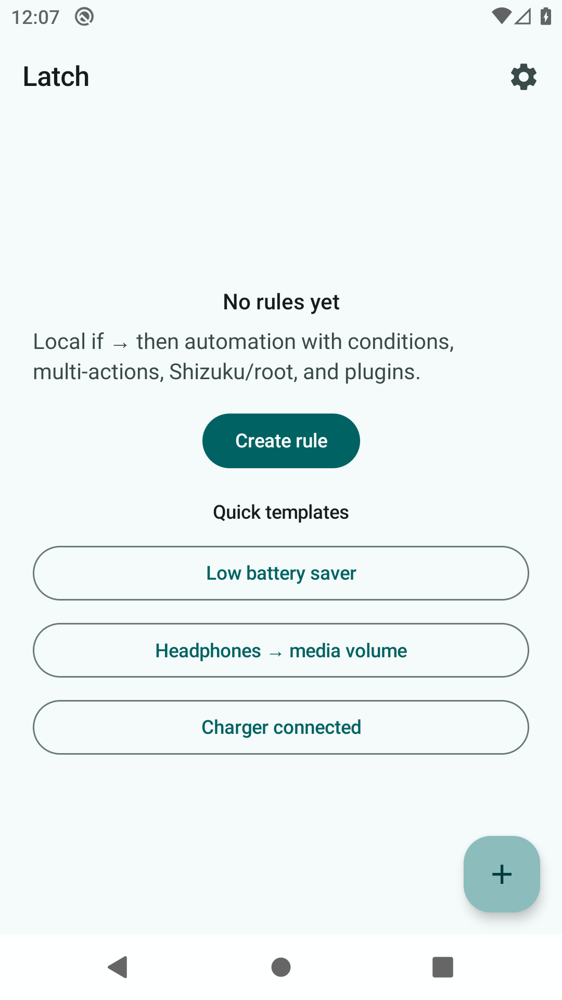
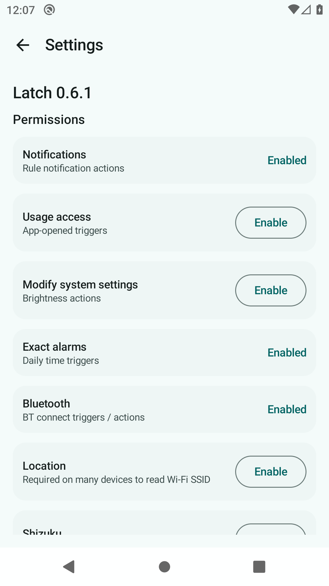
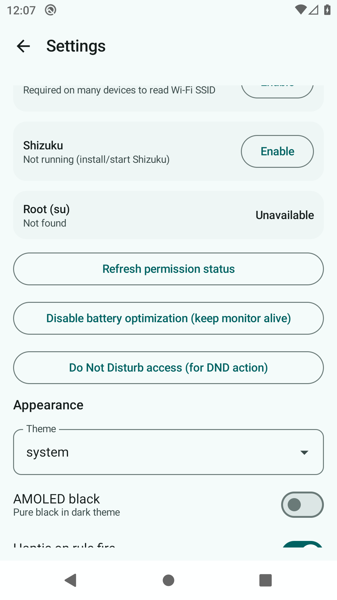
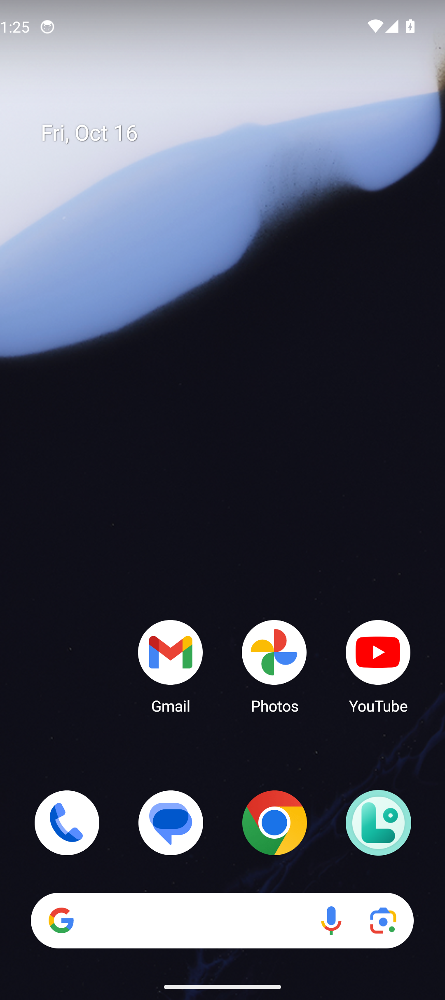

# Latch

<p align="center">
  
</p>

**Privacy-first Android automation** — local *if → then* rules. No account, no cloud, no ads, no trackers.

[](https://github.com/wized2/Latch/actions/workflows/build.yml)
[](LICENSE)

**Site:** https://wized2.github.io/Latch/ · **Releases:** https://github.com/wized2/Latch/releases

## Screenshots

| Home | Settings | Settings (more) | Edit rule |
|:---:|:---:|:---:|:---:|
|  |  |  |  |

## Features

### Triggers
Battery · charger · headphones · daily time · boot · **Wi‑Fi** · **SSID** · **Bluetooth** · **app opened** · screen · **custom broadcast**

### Actions (chainable)
Notify · toast · ringer · **open app** · **open URL** · **brightness** · **shell** (optional root) · wait · **plugin broadcast**

### More
- Multi-step action lists per rule
- Cooldown + notes on each rule
- Home-screen **widget** (toggle a rule)
- **Plugin API** so other FOSS apps can fire triggers / run rules
- JSON export of recipes
- Material You theme (light / dark / system, seed color)

## Elevated access

Optional **Shizuku** (preferred) or root `su` for shell / `svc` style actions. Enable in Settings and grant when prompted.

## Privacy

No `INTERNET` permission. No analytics. Rules stay on device unless you export them.

## Plugin API

```text
com.endroid.latch.api.FIRE_TRIGGER   extra trigger=<string>
com.endroid.latch.api.RUN_RULE       extra rule_id=<uuid>
```

## Install

- [Latest release APK](https://github.com/wized2/Latch/releases/latest)
- Or build from source (below)

## Build

```bash
./gradlew assembleRelease
```

## Related

- **[Fern](https://github.com/wized2/Fern)** — Material You system monitor (CPU, RAM, battery, optional Shizuku)

## License

MIT · Project Endroid

## Support

If Latch helps, a GitHub star makes it easier for others to find. Issues and PRs welcome.
