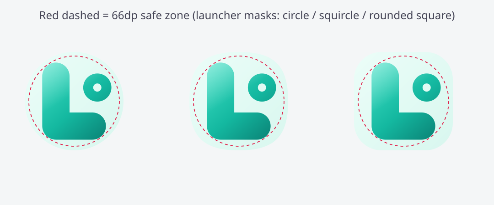

# Latch

<p align="center"></p>


[](https://github.com/wized2/Latch/actions/workflows/build.yml)
[](LICENSE)

**Privacy-first Android automation** — local *if → then* rules. No account, no cloud, no ads, no trackers.

**Site:** https://wized2.github.io/Latch/ · **Releases:** https://github.com/wized2/Latch/releases

## Features

### Triggers
Battery · charger · headphones · daily time · boot · **Wi‑Fi** · **SSID** · **Bluetooth** · **app opened** · screen · **custom broadcast**

### Actions (chainable)
Notify · toast · ringer · **open app** · **open URL** · **brightness** · **shell** (optional root) · wait · **plugin broadcast**

### Other
- Multi-step action lists per rule
- Cooldown + notes
- Home-screen **widget** (toggle rule)
- **Plugin API** for other FOSS apps
- JSON export of recipes
- Material You

## Elevated
Shizuku (preferred) and optional root `su` for shell / svc actions.

## Privacy
No `INTERNET` permission. No analytics. Rules stay on device unless you export them.

## Plugin API
```text
com.endroid.latch.api.FIRE_TRIGGER   extra trigger=<string>
com.endroid.latch.api.RUN_RULE       extra rule_id=<uuid>
```

## Build
```bash
./gradlew assembleRelease
```

## License
MIT · Project Endroid

## Related

- **[Fern](https://github.com/wized2/Fern)** — Material You system monitor

If Latch helps, a star makes it easier for others to find.
